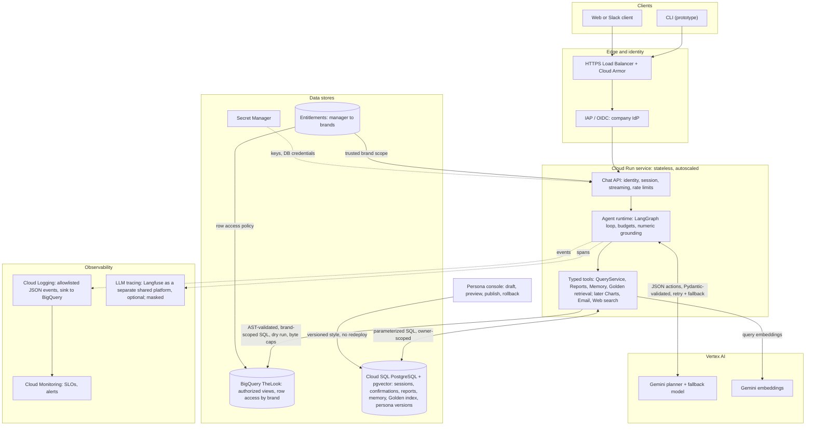
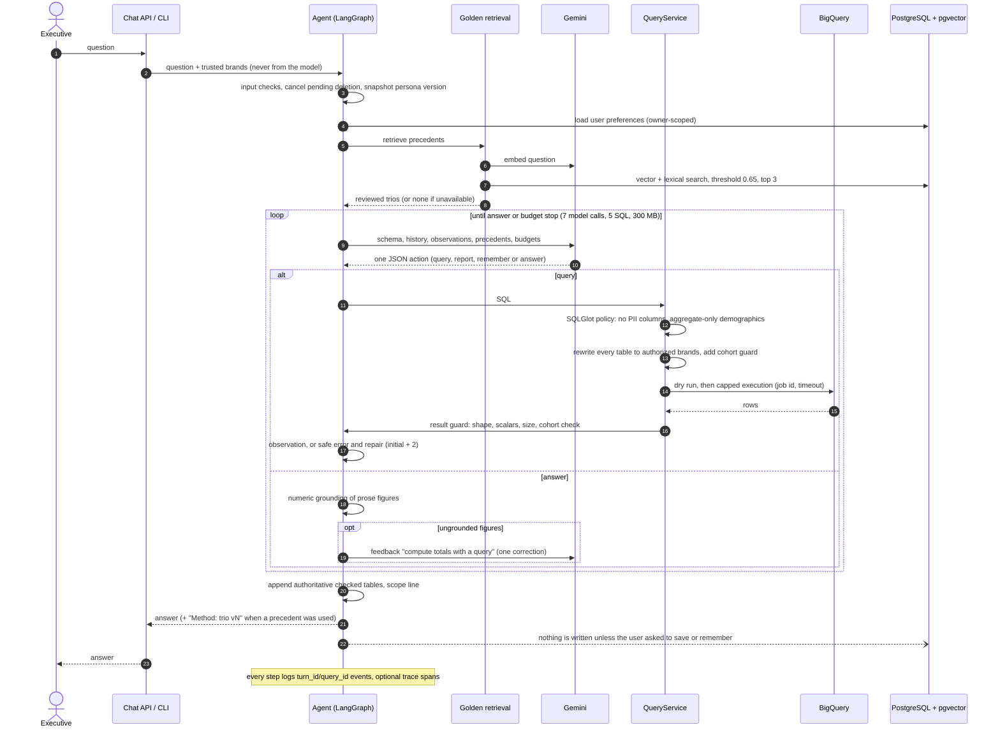
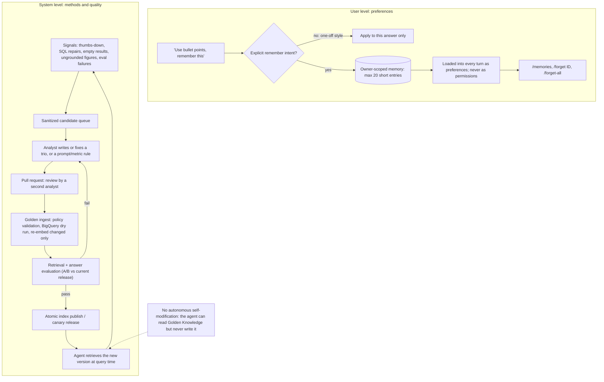

# OpsFleet Retail Analyst: High-Level Design

A chat agent that lets non-technical retail executives ask analytical questions
about sales and performance, discuss the answers, and turn them into reports with
action items. This document is the main design deliverable: architecture, data
flow, technology choices, how each requirement is met, error handling and the
path from the working prototype to production.

**Status labels used throughout:** **Implemented** = runs in the prototype in this
repository and is covered by tests or live runs; **Production** = proposed design,
not deployed. Setup and an example session are in the [README](../README.md).

| # | Requirement | Prototype | Where |
| --- | --- | --- | --- |
| 1 | Hybrid intelligence (Golden bucket) | Implemented: 12 reviewed trios, ingestion, retrieval, evaluation | [§5.1](#51-hybrid-intelligence-golden-knowledge), [GOLDEN_KNOWLEDGE.md](GOLDEN_KNOWLEDGE.md) |
| 2 | Safety and PII masking (required in prototype) | Implemented: lineage-level SQL policy, brand scoping, cohort suppression, result guards | [§5.2](#52-safety-pii-and-access), [QUERY_SAFETY.md](QUERY_SAFETY.md) |
| 3 | Destructive operations (required in prototype) | Implemented: frozen preview + separate `/confirm` | [§5.3](#53-high-stakes-oversight-report-deletion), [SAVED_REPORTS.md](SAVED_REPORTS.md) |
| 4 | Learning loop | User level implemented (explicit memory); system level: reviewed path demonstrated, automation proposed | [§5.4](#54-continuous-improvement), [USER_MEMORY.md](USER_MEMORY.md) |
| 5 | Resilience (required in prototype) | Implemented: bounded SQL repair, model retry + fallback, graceful degradation | [§5.5](#55-resilience-and-error-handling) |
| 6 | Quality assurance | Implemented: 241 tests, retrieval eval, live answer eval with A/B | [§5.6](#56-quality-assurance), [EVALUATION.md](EVALUATION.md) |
| 7 | Observability (required in prototype) | Implemented: correlated JSON events, metrics report, per-turn timeline, optional Langfuse | [§5.7](#57-observability), [OBSERVABILITY_AND_ACCESS.md](OBSERVABILITY_AND_ACCESS.md) |
| 8 | Persona management | Implemented: style-only Google Doc, refreshed per question | [§5.8](#58-persona-management), [PERSONA_MANAGEMENT.md](PERSONA_MANAGEMENT.md) |

## 1. Scope and assumptions

- **Users:** executives and brand managers. Each manager may analyze only the
  brands they are entitled to (stakeholder decision: brand is the access
  dimension; a mock manager-to-brand mapping is acceptable for the prototype).
- **Data:** `bigquery-public-data.thelook_ecommerce` tables `orders`,
  `order_items`, `products`, `users`, read-only. The schema is fixed; brand scope
  is applied per table, not per dataset.
- **PII rules (confirmed with Harry and Vlad, [STAKEHOLDER_POLICY.md](STAKEHOLDER_POLICY.md)):**
  names, email, street address, postal code and coordinates never reach the model
  or the output; age, gender, city, state, country and traffic source only in
  aggregates; customers may be referred to by `user_id`; filtering on a
  demographic and then listing individuals is blocked; small demographic groups
  are suppressed (configurable minimum, default 5 distinct buyers).
- **Business defaults:** revenue = `SUM(order_items.sale_price)` for status
  `Complete`; estimated gross profit = `sale_price - products.cost` (current
  catalog cost); "last month" = the previous full calendar month. Golden trios
  carry these definitions so they are applied consistently.
- **Not in scope of the prototype:** real authentication, a web UI, multi-tenant
  deployment. The CLI uses a trusted startup identity (`--manager`).

## 2. Architecture

### 2.1 Production serving architecture (Production)

| Building block | Service | Why |
| --- | --- | --- |
| Edge and identity | HTTPS Load Balancer, Cloud Armor, IAP/OIDC | Company SSO; identity and entitlements never come from the chat or the model |
| Chat API + agent runtime | Cloud Run (one container, stateless) | Scales to zero, per-request concurrency, simple deploys; the agent loop is short and I/O-bound |
| Planner and embeddings | Vertex AI Gemini (+ fallback model), Gemini embeddings | Same models as the prototype; Vertex adds IAM, regional processing and quotas per project |
| Analytical data | BigQuery with authorized views / row access policies by brand | Data already lives there; dry runs, byte caps and job IDs give cost control and cancellation |
| Application state | Cloud SQL PostgreSQL + pgvector | Reports, memory, sessions, pending confirmations, Golden index and persona versions need transactions; pgvector avoids a separate vector service at this scale |
| Golden bucket | Cloud Storage (versioned) + pull-request review | Immutable trio versions and audit trail; ingestion publishes into pgvector |
| Secrets | Secret Manager | API keys and DB credentials out of images and config |
| Observability | Cloud Logging (sink to BigQuery) and Cloud Monitoring; LLM tracing in Langfuse, a separate shared platform service, if the organization runs or buys one ([§5.7](#57-observability)) | Metadata events for metrics and alerts; masked traces for deep dives |
| Offline jobs | Cloud Run Jobs, Cloud Build, Cloud Scheduler | Golden ingestion, evaluation gates, feedback mining ([§5.4](#54-continuous-improvement)) |

### 2.2 One question, end to end (Implemented, except the API hop)

1. The trusted identity resolves to authorized brands before anything else; the
   model only ever sees them as information.
2. Per turn, the agent snapshots the persona version, loads the user's
   preferences and retrieves up to three Golden precedents.
3. The planner returns exactly one JSON action per step (`query`, `report`,
   `remember`, `answer`), validated by Pydantic. Invalid output gets up to two
   corrections before any tool runs.
4. A `query` passes the SQL policy, is rewritten so every physical table is
   restricted to the authorized brands, gets a cohort guard if it touches
   demographics, is dry-run against a byte cap and then executed with a timeout.
   Rows pass the result guard before the model sees them.
5. Failed SQL returns a safe reason and the attempted SQL for repair (initial
   attempt plus two repairs). The loop is bounded per turn: 7 model calls, 5 SQL
   attempts, 300 MB of scanned bytes.
6. The final prose is checked for ungrounded figures, then the app appends the
   authoritative checked tables itself. Nothing is persisted unless the user asked
   to save a report or to remember a preference.

### 2.3 Prototype vs production

| Concern | Prototype (local) | Production |
| --- | --- | --- |
| Client and identity | CLI, `--manager` + `access.local.json` | Web/Slack client, OIDC, entitlement service |
| Runtime | `python main.py` on the host | Cloud Run service |
| Models | AI Studio API key, `GEMINI_MODEL` + `GEMINI_FALLBACK_MODEL` | Vertex AI with service-account IAM |
| Access enforcement | Application SQL rewriting with trusted brand parameters | Same, plus BigQuery authorized views / row access policies as a second layer |
| State | PostgreSQL 17 + pgvector in Docker Compose | Cloud SQL with HA, backups, private IP |
| Golden bucket | `golden/trios/*.json` in Git | Cloud Storage + PR review + ingestion job |
| Observability | `logs/agent.jsonl`, metrics CLI, optional local Langfuse | Cloud Logging, Monitoring dashboards and alerts, redacted traces |
| Persona | Public-link Google Doc (style only) | Authenticated persona console with versions |

## 3. Technology choices

**Python + direct Google Gen AI SDK.** Structured output with a JSON Schema
generated from Pydantic, validated again locally; explicit timeouts, error
classification and our own bounded retry/fallback policy. No LangChain wrappers
between us and the model, so the request and its failure modes stay visible.

**LangGraph as a thin, explicit state machine.** Four nodes (`plan`, `query`,
`reports`, `remember`) with conditional edges and a recursion limit. All business
logic lives in plain Python classes (`QueryService`, `ReportLibrary`,
`UserMemory`, `GoldenKnowledge`, validators), so the framework is replaceable.
LangGraph's `interrupt()` + checkpointer was deliberately not used for deletion
confirmation: confirmation must be a separate user command that never passes
through model-driven state, and the CLI prototype has no session store. In
production the pending confirmation is a server-side record ([§5.3](#53-high-stakes-oversight-report-deletion)).

**Gemini models.** A current Flash-Lite model as the planner: one question takes
2-4 short structured calls, so latency and cost matter more than peak reasoning;
the evaluation shows it is adequate when guided by Golden precedents. A stronger
Flash model is configured as the fallback. `gemini-embedding-2` (768 dimensions)
serves reports, memory and Golden retrieval with one vector space. Model IDs are
configuration, chosen by evaluation, not hard-coded claims.

**SQLGlot** parses and qualifies BigQuery SQL so policy is checked on resolved
column lineage (which table and column each expression reads), not on keywords
or output names. Version pinned via `uv.lock` and wrapped behind
`sql_validator` / `query_scope`. In production the data layer (authorized views,
row access policies) becomes the primary boundary and SQLGlot the second layer;
forking or trimming the parser would add risk without benefit.

**PostgreSQL + pgvector** for all application state, including vectors: one
transactional store, parameterized queries, owner scoping, and exact search that
is fast at hundreds to thousands of rows.

**Alternatives considered.**
- *Google ADK*: strong for multi-agent systems and deployment to Vertex Agent
  Engine. This problem is one agent with a tightly controlled loop and
  deterministic safety steps, where an explicit graph is easier to reason about
  and test. Because logic is framework-independent, moving to ADK on GCP later is
  straightforward.
- *LangChain SQL agents/toolkits*: hide the SQL execution path that the safety
  design must control.
- *Mem0 for user memory*: more than needed for short explicit preferences; Vlad
  confirmed a lightweight module is fine.
- *Qdrant / Vertex AI Vector Search*: justified only when measured corpus size or
  latency requires a separate index.

**Experience.** My background is on-premise ML infrastructure: provisioning VMs
from scratch and serving models, including vision-language models, on them. I
use LangGraph comfortably and prefer to keep it thin, with logic in my own
classes. SQLGlot was selected specifically for this task as the open-source parser that
makes lineage-aware SQL validation possible. The GCP managed services above map directly onto
infrastructure I have built and operated by hand.

## 4. Data: where it lives and how it is handled

| Data | Store | Who can read/write | Notes |
| --- | --- | --- | --- |
| Transactions, products, customers | BigQuery (read-only) | Agent via QueryService only | Brand-scoped per table; PII columns blocked before execution |
| Query observations | Process memory, then model context | Agent | Only result-guarded rows, max 200 rows / 256 KB per query |
| Conversation history | Process memory (prototype); Cloud SQL sessions (production) | Agent | Bounded: 6 turns / 20,000 characters |
| Saved reports | PostgreSQL `saved_reports` | Owner, if current brands cover the report's brands | Snapshot of the previous answer with checked tables; embedding for search |
| User memory | PostgreSQL `user_memories` | Owner | Max 20 entries x 200 characters; explicit consent; `/forget` |
| Golden index | PostgreSQL `golden_trios` | Agent: SELECT only; ingestion role: write | Rebuildable from the bucket |
| Persona | Google Doc (prototype); Cloud SQL versions (production) | Admins edit; agent reads | Style only; mandatory policy stays in code |
| Logs | `logs/agent.jsonl`; Cloud Logging | Operators | Allowlisted metadata fields: IDs, codes, counts, durations, tokens; no prompts, SQL or rows |
| Traces (optional) | Local Langfuse; production: shared Langfuse platform or none | Restricted | Prototype traces contain raw prompts: demo data only |

**What leaves the trust boundary:** questions, result-guarded rows, report text,
memory entries and trio text are sent to Google (Gemini, embeddings). Direct PII
never is, because it is blocked at the SQL level before execution.

## 5. Requirements

### 5.1 Hybrid intelligence: Golden Knowledge

**Implemented.** A trio is a reviewed analytical method: question and
paraphrases, the analyst's interpretation (definitions, period rules, pitfalls),
metric formulas, grain, reviewed SQL and a report structure with
`<placeholders>` instead of numbers, so examples are never mistaken for current
data. Twelve trios cover the assignment's examples.

- **Updating the bucket over time:** `python -m retail_agent.golden.ingest`
  validates the whole bucket (the same SQL policy as model SQL; one bad trio
  publishes nothing), optionally dry-runs every SQL in BigQuery, re-embeds only
  changed trios by content hash, removes withdrawn ones and publishes in one
  transaction under a separate writer role. Two trios were revised to v2 after
  live runs exposed weak methods: the churn proxy and the quarterly totals.
- **Providing it at query time:** before planning, the question (plus the
  previous one for short follow-ups) is embedded, pgvector returns 10 candidates,
  a lexical match breaks ties, a 0.65 similarity threshold and top-3 limit apply
  within a prompt budget. Answers that follow a precedent end with
  `Method: <trio_id> v<version>`. If retrieval fails, planning continues without it.
- **Evidence:** retrieval recall@3 0.96 on 30 English/Russian cases; answer
  evaluation judge pass rate 1.00 with Golden vs 0.60 without.

**Production:** Cloud Storage bucket, PR review by a second analyst, CI ingestion
and evaluation gate, tenant/visibility filters applied before ranking, a reranker
for the 0.63-0.67 similarity overlap, trios promoted from flagged conversations.

### 5.2 Safety, PII and access

**Implemented**, as layers that do not trust each other ([security-pii.mmd](security-pii.mmd)):

1. **Input:** length limit; email/phone patterns rejected; CLI identity is
   fixed at startup and brands come from trusted config, never from chat.
2. **Column policy:** every column is `allowed`, `aggregate_only`, `blocked_pii`
   or `blocked_unscoped` (not personal, but mixes brands, e.g.
   `orders.num_of_item`) in a curated catalog. Blocked columns are not shown to
   the model. Unknown columns fail closed.
3. **SQL policy on resolved lineage (SQLGlot):** one read-only SELECT; no DML/DDL,
   wildcards, UDFs, external or identity functions, parameters; blocked columns
   rejected anywhere (select, filter, join, subquery, alias). This answers the
   stakeholder note that keyword or column-name matching is not robust.
4. **Demographic shape:** if any aggregate-only column is used, the query must be
   one flat aggregate over canonical joins; individual IDs may not appear in
   outputs, filters or groupings, so "IDs of 26-year-olds" and "age of our top
   spender" are rejected.
5. **Brand scoping:** every physical table, including inside CTEs and subqueries,
   is replaced by a subquery filtered to the authorized brands with a trusted
   BigQuery array parameter. Customer metrics therefore include only purchases of
   authorized brands.
6. **Cohort guard:** code adds a distinct-buyer count and `HAVING >= k` before
   ORDER/LIMIT for demographic queries; results are re-checked and the counter
   stripped. Product revenue with two buyers is allowed (no identities attached).
7. **Result guard:** columns must match the validated projection; only scalars;
   size bounds; contact-detail patterns rejected before the model sees anything.
8. **Output:** text checks, numeric grounding, and app-rendered tables instead of
   model-written ones. The model is instructed to answer only analysis questions;
   off-topic and malicious requests are refused (verified in the answer eval).

Prompt injection: question text, history, database strings, reports and trios are
data. They cannot change access (the brand parameter is outside the model's
reach) or confirm deletion (only a separate CLI command can).

**Residual risk and production:** combining answers across questions
(differencing) is not prevented, as agreed with Vlad. Production mitigations:
authorized views as the primary boundary, per-user query budgets on demographic
dimensions, consistent suppression, overlap detection between recent demographic
queries, and differential privacy for high-risk aggregates where utility allows.
Free-text PII detection beyond patterns (e.g. Cloud DLP) for inputs and traces.

### 5.3 High-stakes oversight: report deletion

**Implemented** ([report-deletion.mmd](report-deletion.mmd)): "Delete all reports
mentioning Client X" or "...made in this conversation" produces a **preview**
(literal match, conversation, ID or all; never vector similarity), capped at 100
and frozen as exact IDs for 5 minutes. Only a separate `/confirm` command deletes,
bypassing the model, re-checking owner and current brands inside one transaction,
and reporting the actual count. Any new question, `/cancel`, `/reset` or restart
invalidates the preview; reports created after the preview are never included.
UX stays fluent: the preview lists titles and IDs and says exactly what to type.

**Production:** pending confirmation stored server-side with a signed single-use
token bound to user, session and the hash of the frozen IDs; idempotency key and
audit record; UI confirmation button instead of a typed command.

### 5.4 Continuous improvement

**User level (Implemented):** explicit `remember` intent (model action plus a
code-level check for "remember"/"запомни") stores short preferences such as
"prefers tables" or "brief answers", loaded into every turn as preferences, never
as permissions. `/memories`, `/forget ID`, `/forget-all`. Known gaps: no
supersession of conflicting preferences, no implicit learning of depth or format.
**Production:** pinned preferences plus selective retrieval, conflict
supersession, implicit preference proposals that the user confirms, TTLs.

**System level:** the agent never modifies itself. Improvements flow through
reviewed artifacts (trios, prompt rules, metric definitions) and an evaluation
gate. Demonstrated manually in the prototype: live runs and the evaluation exposed
two weak methods and a prose-arithmetic failure; trios were revised to v2, a
grounding check was added, and the A/B evaluation confirmed the effect.
**Production:** signals (thumbs-down, repairs, empty results, ungrounded figures,
evaluation failures) feed a sanitized queue; analysts write or fix trios through
pull requests; the ingest job and evaluation gate publish; canary and rollback.

### 5.5 Resilience and error handling

| Failure | Behaviour | Status |
| --- | --- | --- |
| SQL syntax/semantic error, policy rejection | Safe reason + attempted SQL back to the model; initial attempt + 2 repairs; then an honest partial answer with the last checked result | Implemented; 7/7 dry-run rejections recovered in the eval |
| Empty result | Reported as "no publishable rows" (may be suppression), model may revise filters it invented, never the user's | Implemented |
| Premature answer after only failures | Forced repair instead of an answer without evidence | Implemented |
| Invalid JSON / action from the model | Up to 2 corrections before any tool runs | Implemented |
| Gemini 503 / 429 / connection error | One retry with backoff or Retry-After (<= 8 s), then one call to the fallback model | Implemented; fallback answered 5 times during eval runs |
| Gemini timeout, daily quota, model not found | Straight to the fallback model | Implemented |
| BigQuery timeout, quota, outage | Stop that query (no blind replay of possibly-billed jobs), cancel job by ID, partial answer | Implemented |
| Cost | Dry run vs per-query cap (100 MB billed), per-turn 300 MB, row and size caps; unknown billing reserves the ceiling | Implemented |
| Ungrounded figures in prose | One SQL correction, otherwise a visible note | Implemented |
| PostgreSQL, embeddings, persona, Golden, tracing down | Analysis continues; memory and Golden empty, last good persona; saves/deletes never claim success when unconfirmed | Implemented |
| Startup misconfiguration | Failing stage and exception class printed and logged, never the exception text | Implemented |
| UI | The CLI loop catches everything at its boundary; the user can always ask again | Implemented |

**Production adds:** end-to-end request deadlines, circuit breakers per
dependency, admission control and per-tenant quotas, idempotency keys on writes.

### 5.6 Quality assurance

**Implemented** ([EVALUATION.md](EVALUATION.md)): 241 unit/regression tests;
retrieval evaluation (30 cases); live answer evaluation (15 cases: analytics,
reports, UX, safety) with deterministic checks (reference numbers from reviewed SQL
under the same brand scope, required and forbidden SQL, numeric grounding, PII,
refusal and access patterns) plus an LLM judge for intent coverage, caveats and
actionability. The judge missed a wrong prose total, so numeric faithfulness is
checked in code. Golden on/off A/B: 15/15 vs 14/15 deterministic, 1.00 vs 0.60
judge pass rate.

**Production:** 100-300 stratified cases from real questions, repeated runs, judge
calibrated against analysts, release blocked on any safety or reference failure,
canary metrics. UX: moderated sessions with executives (task success, turns to a
useful answer, understanding of the deletion preview, trust calibration) plus
in-product feedback and implicit signals.

### 5.7 Observability

**Implemented.** Every component writes allowlisted JSON events to
`logs/agent.jsonl` (no prompts, SQL, rows or exception text). Correlation keys:
`turn_id` on every turn event, `query_id` + `turn_id` on every query event.

Agent-level metrics, computed by `python -m retail_agent.observability.metrics`
(values from the 60 evaluation turns):

| Metric | Why | Eval value |
| --- | --- | --- |
| Partial answer rate | Turns ending in a controlled stop | 0.0 |
| SQL first-attempt success, recovery after error | Planner quality, repair effectiveness | 0.82, 1.00 |
| Failures by code and stage | Where queries break (validation, dry run, execution) | 7 x `query_rejected` at dry run |
| Model failures, retries, fallbacks, answering model | Provider health and fallback use | 5 retries, 5 fallbacks |
| Golden hit rate, top similarity, most used trios | Retrieval health and knowledge coverage | 0.87, p50 0.75 |
| Ungrounded figures (repaired / noted) | Faithfulness risk | 3 repaired |
| Latency p50/p95, model calls, SQL attempts, tokens, scanned MB per turn | UX and cost | 5.2 s / 10.5 s, 1.85, 0.8, 8.8k, 16 MB |
| Report operations, confirmed deletions, dependency warnings | Destructive actions and degraded dependencies | per run |

**Deep dive:** `--turn <turn_id>` prints the timeline of one turn (model calls
with tokens and chosen action, each query's dry run, execution, row counts and
failure stage, retrieval, grounding repairs). With Langfuse enabled the same
`turn_id` opens the full trace with prompts and model outputs (demo data only,
because traces are not redacted yet).

**Two layers, two jobs.** The JSON events are the always-on, content-free layer:
metrics and alerts ("how often and where does it fail"). Traces are the deep-dive
layer with full content ("why did this turn fail"). `observability/tracing.py` is
the Langfuse integration itself, not a separate system; it is opt-in because
prototype traces carry raw prompts, SQL and result rows.

**Production metrics and alerts:** the same events to Cloud Logging with a
BigQuery sink for these metrics as dashboard queries; alerts in Cloud Monitoring
on partial-answer rate, model error/fallback rate, SQL recovery drop, p95 latency,
cost per turn and any safety rejection spike; SLO proposal: 99.5% availability,
p95 under 30 s for single-query questions.

**Production tracing is a platform decision.** Langfuse is not part of this
application. It is a separate service with its own stack (web and worker,
PostgreSQL, ClickHouse, Redis, object storage) that lives outside the project and
serves many projects and teams, each with its own organization, project and keys.
The local Docker Compose stack only simulates it for development. Whether and how
to run it depends on the organization's capacity and data rules:

| Option | Fits when | Operations |
| --- | --- | --- |
| Shared self-hosted Langfuse, run by a platform team on GCP (GKE or Cloud Run, Cloud SQL, ClickHouse, Cloud Storage, Memorystore) | Several AI projects need LLM tracing and data must stay in our cloud | Highest, shared across projects |
| Managed Langfuse Cloud | A data-processing agreement and region are acceptable | Lowest; masking still mandatory |
| No LLM tracing platform: Cloud Logging + Cloud Trace with allowlisted events, plus sampled debug payloads in a restricted bucket | Neither of the above is available | Low; no prompt-level UI |

The application only needs an OpenTelemetry-compatible exporter and keys from
Secret Manager, so the choice is configuration, not code. Before tracing is
enabled by default under any option: masking through the SDK `mask` hook (reuse
the contact-detail patterns, drop raw result rows, keep shapes and counts);
separate spans for SQL validation, dry run and execution; domain signals as trace
tags or scores (partial answer, SQL recovery, ungrounded figures, Golden trio
used); evaluation results as scores; retention and access rules per project.
Alerting stays in Cloud Monitoring either way.

### 5.8 Persona management

**Implemented:** the editable part of the instructions (tone, structure,
brevity) is a Google Doc fetched as plain text once per question; changes apply to
the next question without redeploying. Mandatory policy (scope, SQL, PII, access,
budgets, deletion) stays in code and overrides the style text. Failures keep the
last good version; the version hash is logged.

**Production:** a persona console for non-developers: structured fields
(tone, length, format, audience) plus free text, preview on fixed questions,
evaluation gate on tone adherence and numeric fidelity, versioned publish and
rollback, audit log; the agent snapshots one version per turn.

## 6. Extensibility: adding a capability

New capabilities are typed tools, not free-form model powers:

1. Define a Pydantic action (e.g. `chart`: chart type, the `query_id` of a checked
   result, fields; `email`: report ID and recipients from an allowlist).
2. Implement it as a service class with its own validation, budget and errors.
3. Add a graph node and an edge from `plan`; add the action description to the
   instructions.
4. Decide its risk class: read-only (charts, web search) runs directly;
   outbound or destructive (email, export, delete) uses the same preview +
   confirmation pattern as report deletion.
5. Add tests and evaluation cases before enabling it.

Charts render only from checked results (never model-invented data); email sends
saved reports only to entitled recipients; web search results are untrusted data
and are cited separately from database facts.

## 7. Rollout

1. Pilot: Cloud Run + Vertex AI + Cloud SQL, authorized views per brand, OIDC,
   one business unit, evaluation gate in CI.
2. Durable sessions and confirmations, persona console, redacted tracing.
3. Golden bucket on Cloud Storage with PR review and feedback mining.
4. New tools (charts, email) behind the confirmation pattern.

## 8. Known limitations of the prototype

- No real authentication; the operator chooses the demo identity at startup.
- Access is enforced by application SQL rewriting; the data layer is not yet a
  second boundary.
- Cross-question inference is documented, not prevented.
- Email/phone patterns are not general free-text PII detection; optional
  Langfuse traces are not redacted.
- Numeric grounding covers money and count figures; derived percentages and
  averages written in prose are not verified (seen in the README example).
- Memory has no supersession of conflicting preferences.
- Evaluation sets are small (30 retrieval, 15 answer cases) and the judge is not
  calibrated against humans.
