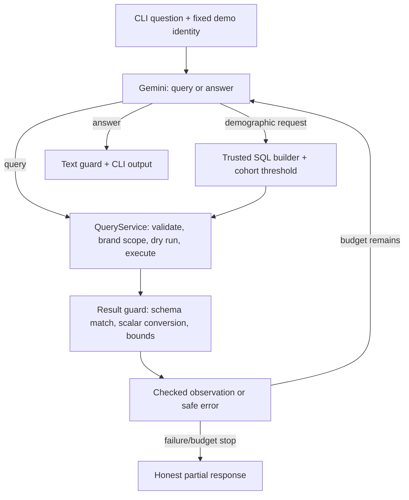

# Retail Analysis Chat — prototype

A CLI analyst for `bigquery-public-data.thelook_ecommerce`, using the Gemini SDK,
a small LangGraph loop, and deterministic SQL validation/brand access controls.

**Current milestone:** iterative analysis, follow-up questions, bounded query
repair, a typed demographic tool, local metadata traces, and a CLI.
Saved-report deletion is NOT implemented yet. This is not the complete assignment
submission or a production security system.

## Setup (Windows PowerShell)

Requires Python 3.13+, [uv](https://docs.astral.sh/uv/), Google Cloud CLI, a
BigQuery billing/quota project, and a Gemini API key from Google AI Studio.

```powershell
uv sync
Copy-Item .env.example .env
Copy-Item access.example.json access.local.json
gcloud auth application-default login
gcloud auth application-default set-quota-project YOUR_PROJECT_ID
```

Edit `.env` locally:

```dotenv
GEMINI_API_KEY=YOUR_API_KEY
GEMINI_MODEL=MODEL_ID_ENABLED_IN_YOUR_AI_STUDIO_PROJECT
GOOGLE_CLOUD_PROJECT=YOUR_PROJECT_ID
RETAIL_MANAGER_ID=manager_a
```

Choose an actual enabled Gemini model ID and check its quota in AI Studio. No
unverified model name is hardcoded as a default. Do not commit `.env` or ADC
credentials. The billing project must have the BigQuery API enabled and permit
query jobs plus reading the public dataset.

### Configure the demo user's brands

Replace the placeholders in `access.local.json` with exact brand names from the
dataset. This is **trusted startup config**, never a chat message. For example:

```json
{
  "manager_a": ["EXACT_DATASET_BRAND_NAME"],
  "manager_b": ["ANOTHER_EXACT_BRAND_NAME"]
}
```

For bootstrap, inspect brands in the BigQuery console using your administrative
dataset access (this query is not an agent tool):

```sql
SELECT DISTINCT brand
FROM `bigquery-public-data.thelook_ecommerce.products`
WHERE brand IS NOT NULL
ORDER BY brand
LIMIT 100;
```

Unknown managers and managers with an empty brand list are denied. Selecting
`--manager` simulates a trusted identity for this local demo; it is NOT real
authentication. The CLI process operator is trusted.

## Run

```powershell
uv run python main.py
```

Optional startup arguments:

```powershell
uv run python main.py --manager manager_a --project YOUR_PROJECT_ID --access-config access.local.json
```

Demographic cohort suppression defaults to 5 distinct contributing buyers per
group. Change it with `--min-cohort-size 5` (minimum accepted value: 2). This is a
prototype policy choice, not a number mandated by the client.

Example questions (actual figures depend on the live dataset and brand scope):

```text
What data can you analyze?
What are the top 5 products by completed-item revenue? Include product IDs.
Which of those products generated the most estimated gross profit?
Show monthly completed-item revenue for the last 6 months.
Are customers aged 24 buying my products? Count distinct buyers.
Which states buy Calvin Klein the most? Show completed revenue.
Create a short report with findings, limitations, and recommended actions.
```

Reports here are generated text, not saved library objects yet.

Commands: `/help`, `/reset`, `/exit`. History is bounded, held only in memory,
and removed on reset/exit. Do not enter personal contact details in the chat.

## How the analytical loop works



LangGraph manages two nodes (`plan`, `query`). It does not grant permissions or
make SQL safe. The Gemini SDK handles structured actions with Pydantic. We do not
use LangChain agents or SQL toolkits. LangGraph brings `langchain-core` and
LangSmith transitively; implicit LangSmith tracing is explicitly disabled during
graph execution, even if enabled in the environment. Langfuse is not connected yet.

There are two tools, not one universal SQL privacy engine:
- **query:** general SQL for non-demographic analysis; SQLGlot resolves columns
  through CTEs, subqueries and windows, while code enforces source/column policies.
- **demographic:** a typed request (dimensions, filters, metrics). Code builds the
  SQL, joins, brand restriction and cohort check. The model does not write this SQL.

For example, age 24 is `filters: {"age_from": 24, "age_to": 24}` with
`metrics: ["customer_count"]`. State revenue uses `group_by: ["state"]`,
`metrics: ["revenue", "customer_count"]`, and `order_by: "revenue"`.

Each question allows at most 5 SQL attempts, 7 model calls, 2 consecutive query
errors, and 300 MB of scan/billing budget accounting. The model is told the
remaining query budget and can answer without another query. Ambiguous timeouts
are not automatically replayed. An execution failure with unknown billing
conservatively consumes the reserved per-query ceiling. Confirmed pre-execution
validation/cost denials do not consume that scan allowance.

QueryService defaults: 100 MB maximum billed bytes per query, 200 result rows,
256 KB result JSON, 30-second query wait, 10-second API timeout. Gemini has a
30-second HTTP timeout, no automatic retries, and a 4,096 output-token cap.
These controls are not a hard end-to-end deadline or an account-wide cost cap.
Limits are defined in `AgentLimits` and `QueryLimits`.
Dry-run failures do not spend the scan allowance: no execution was submitted.
Safe repair feedback includes the previous model-authored SQL (not logged), and
known date/time errors give fixed guidance rather than echoing backend messages.
By default, "last month" means the previous complete calendar month compared to
the month before it, not current month-to-date versus a full month.

## Safety and known limits

- General SQL is validated before any source rewriting. Direct PII references
  are rejected even when renamed or used only in filters/subqueries.
- Every original physical source is independently restricted by trusted brands.
  A visible customer/order does not unlock other brands' purchases.
- Queries use explicit allowed columns, not unrestricted SELECT *. COUNT(*) is
  allowed. Table aliases are recommended; unqualified columns are accepted only
  when exactly one local physical source defines them. Ambiguous references are
  rejected. Computed outputs need aliases.
- CTEs, derived tables, correlated subqueries, set operations and window functions
  are supported for ordinary SQL. Unknown/UDF/external functions, identity
  functions, custom parameters and unreviewed source modifiers remain rejected.
  This is not a promise to support every BigQuery feature or result type.
- Demographic fields cannot be used in the SQL tool, even in filters or CTEs.
  Use the demographic tool instead: it has named dimensions, metrics and filters,
  no raw expressions or customer-ID fields. This is an enforcement boundary, not
  a claim that demographics are prohibited by client policy.
- The demographic builder first aggregates purchases per buyer/group, then
  produces the requested statistics. Average age is over distinct buyers, not
  weighted by repeated purchases. A private contributing-buyer counter and HAVING
  enforce the threshold BEFORE ORDER/LIMIT. Non-null inputs are checked across
  metrics; one known age cannot masquerade as an average over a large null group.
  ResultGuard checks again and removes the counter before the LLM. Empty results
  mean no publishable data, not proof of zero buyers. Rankings cover published groups.
- Ordinary non-demographic product revenue is NOT subject to cohort suppression.
  Cross-question inference protection remains design-only as agreed with Vlad.
- Result guards verify output columns against the validated projection, reject
  nested/nonfinite values, normalize dates/decimals, and bound observations before
  returning them to the model. SQL lineage validation remains the primary control;
  matching result column names alone is not considered a PII guarantee.
- Recognizable email and international-phone patterns in input/results/output are
  rejected as an extra safeguard. This is NOT comprehensive name/address/PII
  detection. Do not use this prototype for arbitrary sensitive free text.
- Database strings are treated as untrusted data in the analyst instructions.
  Prompt instructions alone do not guarantee injection resistance or factuality.
- No cross-query inference protection, real login, or production DB-level access
  enforcement is implemented. Order status/timestamps remain whole-order metadata;
  use item-level facts for brand-specific fulfillment/sales metrics.

## Observability

`logs/agent.jsonl` contains JSON events with IDs, action/stage, durations, row/byte
counts, token usage, and safe error codes. Prompts, SQL, identity, brand lists, raw
rows and exception text are not included. Set `--log-file` to change the path.
These are local events, not a full Langfuse deployment or monitoring dashboard.

### Model failure diagnostics

CLI failures include safe codes rather than treating every exception as overload:

- `model_unavailable`: HTTP 500/502/503/504, temporary provider failure.
- `model_rate_limited` / `model_daily_quota`: HTTP 429, quota/rate limit.
- `model_not_found`: HTTP 404; check GEMINI_MODEL and API availability.
- `model_invalid_key` / `model_access_denied`: API key/access failure.
- `model_schema_rejected` / `model_request_rejected`: HTTP 400 request rejection.
- `model_invalid_json` / `model_invalid_action`: structured response validation.
- `model_output_limit`, `model_empty_response`, `model_response_blocked`:
  token limit, empty generation, or provider safety stop, respectively.
- `model_timeout` / `model_connection_failed`: transport failure.
- `model_configuration_error` / `model_failed`: local SDK/configuration or
  unexpected error; check the safe exception type in the JSON log.

The log includes HTTP status, exception class, safe validation field names/count,
and numeric Retry-After if available, never the raw provider error or Pydantic
input values. Failures do not trigger automatic request retries.

Structured actions use `response_json_schema=AgentAction.model_json_schema()`
and are still validated locally by Pydantic. Passing this model through the SDK's
typed `response_schema` conversion caused a live HTTP 400 (`additional_properties`
was not accepted by the endpoint); the JSON Schema path has been live-tested
with a neutral greeting. This does not validate the full analytic SQL path.

```powershell
Get-Content logs/agent.jsonl -Tail 20
```

## Tests

```powershell
uv run python -m unittest discover -s tests -v
```

Tests run the actual graph, analyst prompts, SQL checks, brand rewriting and
result guard against mocked Gemini/BigQuery backends. SQLite fixtures separately
test row isolation, including mixed-brand purchases. No credentials or paid API
calls are needed for tests. Additional live smoke tests have covered brand access
follow-ups, age-24 buyer counts, geographic aggregates and three-part analysis.
These examples do not replace a broader correctness/security evaluation.

See `HLD/QUERY_SAFETY.md` for implementation details and `HLD/*.mmd` for the
proposed broader architecture. `HLD/STAKEHOLDER_POLICY.md` records the confirmed
Harry/Vlad policy clarifications. Other assignment features remain planned.

### Result delivery

After queries, the application appends ALL current checked result tables,
independently of model prose, and removes model-authored Markdown tables to avoid
duplicates/conflicting numbers. It displays all available checked rows up to the
200-row service bound; there is no 20-row page or scrolling UI. Financial columns
are displayed to two decimal places without changing underlying calculations.
Truncation is explicitly marked. Replies based only on history supply their own
requested table; that generated prose/table is not independently fact-checked.

The model receives actual allowed brand names as access metadata, separate from
budgets. It can answer entitlement questions without querying purchases. The
first accepted user question is stored separately from the bounded recent history;
the model is told when history has been trimmed. /reset clears both.

Default business assumption: revenue is completed-item sale_price (status Complete);
estimated gross profit subtracts current product cost, not historical accounting
cost. Status breakdowns include all statuses intentionally. Ordinary observations
carry normalized submitted SQL, executed with brand scoping; demographic ones
carry the builder's actual structured filters. We no longer maintain a separate
handwritten interpreter of SQL status predicates. The state field is worldwide,
not inherently US-only. Generated prose is not independently fact-checked: even
with correct tables, a model can explain a formula incorrectly. Business metric
and intent evaluations remain necessary.

An answer following only failed queries cannot silently claim fresh results or
end with a placeholder promise to fetch them. Query failures include their safe
cause. Validator-generated reasons (e.g. ambiguous column or unsupported AST
construct) are returned for bounded repair and logged as validation_reason;
arbitrary backend error text and SQL literals are not echoed.

A live smoke test of the profitable-brand question and its top-10 follow-up now
completes under manager_a's three-brand scope. This is one scenario, not a general
correctness evaluation; business metric definitions and model interpretations
still require evaluation.

## Design notes and archive

Start at [HLD/README.md](HLD/README.md). Current implementation, confirmed client
policy, historical experiments and proposed production services are labeled
separately. The old demographic SQL-validator source is preserved in
[HLD/archive/sql-demographic-validator-v1.md](HLD/archive/sql-demographic-validator-v1.md).
It is a reference for tradeoffs, not the recommended production implementation.
