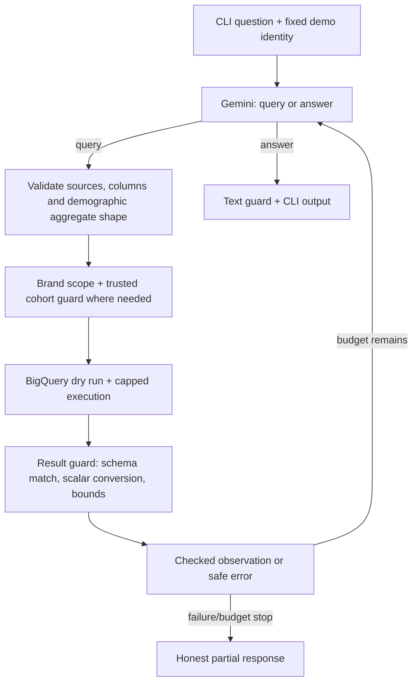

# Retail Analysis Chat — prototype

A CLI analyst for `bigquery-public-data.thelook_ecommerce`, using the Gemini SDK,
a small LangGraph loop, and deterministic SQL validation/brand access controls.

**Current milestone:** iterative analysis, follow-up questions, bounded query
repair, unified analytical SQL (including checked demographic aggregates), saved reports with vector search and explicit
deletion confirmation, optional local Langfuse tracing, local logs, and a CLI.
This is not a production security system; the production HLD remains separate.

## Setup (Windows PowerShell)

Requires Python 3.13+, [uv](https://docs.astral.sh/uv/), Google Cloud CLI, a
BigQuery billing/quota project, and a Gemini API key from Google AI Studio.

```powershell
uv sync
Copy-Item .env.example .env
Copy-Item access.example.json access.local.json
gcloud auth application-default login
gcloud auth application-default set-quota-project YOUR_PROJECT_ID
```

Edit `.env` locally:

```dotenv
GEMINI_API_KEY=YOUR_API_KEY
GEMINI_MODEL=MODEL_ID_ENABLED_IN_YOUR_AI_STUDIO_PROJECT
GOOGLE_CLOUD_PROJECT=YOUR_PROJECT_ID
RETAIL_MANAGER_ID=manager_a
```

Choose an actual enabled Gemini model ID and check its quota in AI Studio. No
unverified model name is hardcoded as a default. Do not commit `.env` or ADC
credentials. The billing project must have the BigQuery API enabled and permit
query jobs plus reading the public dataset.

### Configure the demo user's brands

Replace the placeholders in `access.local.json` with exact brand names from the
dataset. This is **trusted startup config**, never a chat message. For example:

```json
{
  "manager_a": ["EXACT_DATASET_BRAND_NAME"],
  "manager_b": ["ANOTHER_EXACT_BRAND_NAME"]
}
```

For bootstrap, inspect brands in the BigQuery console using your administrative
dataset access (this query is not an agent tool):

```sql
SELECT DISTINCT brand
FROM `bigquery-public-data.thelook_ecommerce.products`
WHERE brand IS NOT NULL
ORDER BY brand
LIMIT 100;
```

Unknown managers and managers with an empty brand list are denied. Selecting
`--manager` simulates a trusted identity for this local demo; it is NOT real
authentication. The CLI process operator is trusted.

## Run

```powershell
uv run python main.py
```

Optional startup arguments:

```powershell
uv run python main.py --manager manager_a --project YOUR_PROJECT_ID --access-config access.local.json
```

Demographic cohort suppression defaults to 5 distinct contributing buyers per
group. Change it with `--min-cohort-size 5` (minimum accepted value: 2). This is a
prototype policy choice, not a number mandated by the client.

Example questions (actual figures depend on the live dataset and brand scope):

```text
What data can you analyze?
What are the top 5 products by completed-item revenue? Include product IDs.
Which of those products generated the most estimated gross profit?
Show monthly completed-item revenue for the last 6 months.
Are customers aged 24 buying my products? Count distinct buyers.
Which states buy Calvin Klein the most? Show completed revenue.
Create a short report with findings, limitations, and recommended actions.
```

To persist a report, first obtain an answer, then explicitly ask to save it:

```text
Save your last answer as a report titled October brand overview.
List my saved reports.
Find my reports related to Calvin Klein revenue.
Open report <32-character-report-ID>.
Delete my reports mentioning October brand overview.
/confirm
```

Saving copies the last completed assistant analysis/answer, including app-rendered
checked tables, not the whole conversation. Report-tool responses do not replace
that snapshot. No fresh SQL is run for saving. Creating AND saving a new analysis
in one request is deliberately two turns in this MVP: analysis first, save next.
There is no autosave. The saved library survives process restarts.

Commands: `/help`, `/reset`, `/exit`, `/confirm`, `/cancel`. History is bounded,
held only in memory, and removed on reset/exit. Reset also changes conversation ID,
clears the last-answer snapshot and pending deletion, but never deletes reports.
Do not enter personal contact details in the chat.

## How the analytical loop works



LangGraph manages three nodes (`plan`, `query`, `reports`). It does not grant permissions or
make SQL safe. The Gemini SDK handles structured actions with Pydantic. We do not
use LangChain agents or SQL toolkits. Langfuse tracing is optional and explicitly
enabled through `.env`; its LangChain callback traces the graph and explicit
generation observations trace Gemini calls. Implicit LangSmith export stays disabled.

There is one analytics action, **query**: the model writes SQL for ordinary and
demographic analysis. SQLGlot resolves source columns and code applies different
checks when aggregate-only fields are used. There is no `demographic` action or
business-specific bucket parameter. For example, `FLOOR(u.age/5)*5 AS age_from`
and `FLOOR(u.age/5)*5+4 AS age_to` express five-year groups directly in SQL.
Rounded aggregates and ratios of approved aggregates use the same validation.
Report operations remain a separate typed `report` action.

Each question allows at most 5 SQL attempts, 7 model calls, 3 consecutive query
failures (initial attempt + TWO automatic repair attempts), and 300 MB of scan/billing
budget accounting. Invalid JSON/action responses also get up to TWO correction
attempts before any tool executes. All repairs share the model-call budget.
Report writes and ambiguous executions are NOT blindly replayed. The model is told the
remaining query budget and can answer without another query. Ambiguous timeouts
are not automatically replayed. An execution failure with unknown billing
conservatively consumes the reserved per-query ceiling. Confirmed pre-execution
validation/cost denials do not consume that scan allowance.

QueryService defaults: 100 MB maximum billed bytes per query, 200 result rows,
256 KB result JSON, 30-second query wait, 10-second API timeout. Gemini has a
30-second HTTP timeout, no automatic transport retries, and a 4,096 output-token cap.
These controls are not a hard end-to-end deadline or an account-wide cost cap.
Limits are defined in `AgentLimits` and `QueryLimits`.
Dry-run failures do not spend the scan allowance: no execution was submitted.
Safe repair feedback includes the previous model-authored SQL (not in local logs;
visible in enabled Langfuse traces), and
known date/time errors give fixed guidance rather than echoing backend messages.
By default, "last month" means the previous complete calendar month compared to
the month before it, not current month-to-date versus a full month.

## Safety and known limits

- General SQL is validated before any source rewriting. Direct PII references
  are rejected even when renamed or used only in filters/subqueries.
- Every original physical source is independently restricted by trusted brands.
  A visible customer/order does not unlock other brands' purchases.
- Queries use explicit allowed columns, not unrestricted SELECT *. COUNT(*) is
  allowed. Table aliases are recommended; unqualified columns are accepted only
  when exactly one local physical source defines them. Ambiguous references are
  rejected. Computed outputs need aliases.
- CTEs, derived tables, correlated subqueries, set operations and window functions
  are supported for ordinary SQL. Unknown/UDF/external functions, identity
  functions, custom parameters and unreviewed source modifiers remain rejected.
  This is not a promise to support every BigQuery feature or result type.
- SQL using demographic columns requires a flat aggregate SELECT with canonical
  INNER JOINs from purchases to users, optionally products. Computed grouped
  expressions are supported. Individual IDs in output/grouping/filters, noncanonical
  joins, demographic CTEs/subqueries/windows/set operations and conditional/nested
  aggregates fail closed. COUNT, SUM, AVG, MIN, MAX are supported with checked inputs.
- Trusted code adds a private DISTINCT contributing-buyer counter and HAVING
  BEFORE ORDER/LIMIT. Both aggregate expressions and their inputs must be non-null
  for the common contributor set. ResultGuard checks again and strips the counter.
  AVG(age) over purchase joins is PURCHASE-WEIGHTED, unlike the former typed tool's
  distinct-buyer average. Empty results mean no publishable data, not zero buyers.
  This restricted SQL subset is not a proof that arbitrary aggregate SQL is safe.
- Ordinary non-demographic product revenue is NOT subject to cohort suppression.
  Cross-question inference protection remains design-only as agreed with Vlad.
- Result guards verify output columns against the validated projection, reject
  nested/nonfinite values, normalize dates/decimals, and bound observations before
  returning them to the model. SQL lineage validation remains the primary control;
  matching result column names alone is not considered a PII guarantee.
- Recognizable email and international-phone patterns in input/results/output are
  rejected as an extra safeguard. This is NOT comprehensive name/address/PII
  detection. Do not use this prototype for arbitrary sensitive free text.
- Database strings are treated as untrusted data in the analyst instructions.
  Prompt instructions alone do not guarantee injection resistance or factuality.
- No cross-query inference protection, real login, or production DB-level access
  enforcement is implemented. Order status/timestamps remain whole-order metadata;
  use item-level facts for brand-specific fulfillment/sales metrics.

## Editable style persona (optional Google Doc)

Only presentation is editable: tone, audience, brevity and narrative format.
Security/tool instructions and dynamic schema/brands/results stay in code/context.
The default style works without external configuration.

For the MVP, create a Google Doc with non-sensitive style instructions, for example:

```text
Use a concise, businesslike tone for executives.
Start with up to three key findings, then limitations and recommended actions.
Avoid filler and long repetitions of numbers already shown in the checked table.
```

Restrict editing to the trusted administrator, and enable **Anyone with the link:
Viewer** for this style-only document. Never put secrets, PII or confidential data
in it. Private/authenticated Google Docs are not supported by this MVP loader.
If public-link sharing is prohibited, leave the setting empty and use the default.

Copy the ID from `https://docs.google.com/document/d/DOCUMENT_ID/edit` into `.env`
(pasting the full standard Google Docs link also works):

```dotenv
PERSONA_GOOGLE_DOC_ID=DOCUMENT_ID
```

Restart the CLI once to load this setting. Subsequent edits to document content
are fetched on the next question, with no restart/redeploy. Within one question,
all steps use the same persona. Google export may have propagation delay.
The loader accepts at most 4,000 characters/16 KB. On fetch failure it keeps the
last good in-process style, or the built-in default. Check `persona_loaded` /
`persona_load_failed` events in local logs and the source/version prefix in the
Langfuse Gemini system instruction. Nothing is fetched when the setting is empty.

This changes generated prose only, not saved report contents, checked tables,
CLI messages or permissions. The production admin-console design is in
[HLD/PERSONA_MANAGEMENT.md](HLD/PERSONA_MANAGEMENT.md).

## Observability

`logs/agent.jsonl` contains JSON events with IDs, action/stage, durations, row/byte
counts, token usage, and safe error codes. Prompts, SQL, identity, brand lists, raw
rows and exception text are not included. Set `--log-file` to change the path.
These local events are separate from the optional Langfuse dashboard.

### Separate PostgreSQL for Saved Reports

The root Compose file includes `reports-postgres` (PostgreSQL 17 + pgvector) for the report
library. Langfuse keeps its own `postgres` service; neither database nor volume
is shared between them. MySQL is no longer used.
Start only the reports database (without requiring the Langfuse stack):

```powershell
docker compose up -d --wait reports-postgres
```

Local connection: `127.0.0.1:5433`, database/user `retail_agent`, demo password
`local-reports-demo`. Settings are listed in `.env.example`. Only loopback is
exposed, data persists in `reports_postgres_data`, and the CLI account can
SELECT/INSERT/UPDATE/DELETE reports, but has no superuser/DDL privileges.

`docker/reports-postgres/001_saved_reports.sql` creates the application role/table;
`002_vectors.sql` adds pgvector, the embedding, model ID and trusted brand scope.
Both run automatically on a NEW volume. For an existing reports volume, first
update the container image, then apply the idempotent migration without deleting data:

```powershell
docker compose up -d --wait reports-postgres
Get-Content docker/reports-postgres/002_vectors.sql -Raw | docker compose exec -T reports-postgres psql -U postgres -d retail_agent -v ON_ERROR_STOP=1
```

If switching images produces a collation-version warning, reindex before refreshing
the version (already done for this development workspace):

```powershell
docker compose exec -T reports-postgres psql -U postgres -d retail_agent -v ON_ERROR_STOP=1 -c "REINDEX DATABASE retail_agent;" -c "ALTER DATABASE retail_agent REFRESH COLLATION VERSION;"
```

The CLI connects lazily, so unavailable report storage does not block BigQuery
analysis. `psycopg` uses parameterized operations, a 3-second connect timeout and
5-second statement timeout. Ownership is checked in every read/write/delete;
table grants/indexes alone do not enforce it. Current brands must contain the
saved brand scope; legacy rows without provenance are withheld.

Embeddings use `gemini-embedding-2`, 768 dimensions, via the existing Gemini API
key. The formatted title/content is capped at **8,000 UTF-8 bytes** (a conservative
MVP input bound); oversized answers are rejected, never silently truncated.
Save sends the complete bounded snapshot to Google, then inserts text/vector
atomically. Search sends a query embedding and returns up to 10 owner/brand-scoped
candidates, prioritizing literal query matches, with bounded excerpts. Exact
vector search needs no ANN index for this small library. Results are historical
snapshots and nearest neighbors are not guaranteed relevant matches.

Deletion uses literal substring, report ID, current conversation or explicit all-
reports scope, NOT semantic nearest neighbors. Preview freezes at most 100 IDs
and requires a separate `/confirm` within 5 minutes. `/cancel`, `/reset`, process
exit or any new ordinary question cancels it. Confirmation bypasses Gemini,
rechecks owner/brands and transactionally deletes only previewed IDs. It is
single-use, including on failure; get a fresh preview before retrying. No database
success is claimed on ambiguous connection/commit errors.

Demo credentials are not for production. See [HLD/SAVED_REPORTS.md](HLD/SAVED_REPORTS.md).

### Local Langfuse dashboard (optional)

Install/start Docker Desktop (Linux containers). The root `docker-compose.yaml`
runs Langfuse from ready-made images alongside its storage services; there is
**no need to clone the Langfuse source repository**. Fixed demo credentials and
the required encryption key are already in Compose. No `.env.langfuse` or manual
secret generation is required. **Local MVP only, not production.** Langfuse UI,
media ports and the reports PostgreSQL port are exposed only on loopback; Langfuse's
databases stay internal.
From this repository root:

```powershell
docker compose up -d
docker compose ps
```

This starts several services, not just one container. Open
<http://localhost:3000>, sign up locally (no default login), create an organization
and project, and generate project API keys. No Langfuse Cloud account or LangSmith
Enterprise license is needed. Add the LOCAL project's keys to this app's `.env`:

```dotenv
LANGFUSE_TRACING_ENABLED=true
LANGFUSE_PUBLIC_KEY=pk-lf-your-local-project-key
LANGFUSE_SECRET_KEY=sk-lf-your-local-project-key
LANGFUSE_BASE_URL=http://localhost:3000
```

Run `uv sync`, restart the CLI, ask a question, then open **Tracing** in your local
Langfuse project. Each `retail_question` run shows `plan`/`query` steps, their state
updates and nested `Gemini` generations with input, validated actions and usage.
The trace's `turn_id` matches local log events. Query failures handled by the
agent appear as error observations, not necessarily red failed spans. BigQuery
sub-stages are not individually instrumented yet. Events are batched in the
background and flushed on normal CLI shutdown; allow a short delay in the UI.

**Privacy warning:** tracing exports graph state and Gemini I/O, including
questions, history, SQL, brand lists and observations. Comprehensive trace PII
redaction is deferred; enable only with demo/non-sensitive inputs. Existing data
guards remain enabled but do not sanitize every trace field. Set
`LANGFUSE_TRACING_ENABLED=false` to disable export. Never commit the API keys.
Local hosting does not remove the need for trace redaction and access control.

Stop the local stack without deleting its data:

```powershell
docker compose down
```

Do not add `-v` unless you intend to delete stored traces and other volume data.
The Python CLI still runs on the host with `uv run python main.py --manager manager_a`.
The Compose file is adapted from the
[upstream local deployment](https://langfuse.com/self-hosting/deployment/docker-compose);
this is not a production/high-availability setup.

Production trace privacy and brand-list scaling are explicitly deferred in
[HLD/OBSERVABILITY_AND_ACCESS.md](HLD/OBSERVABILITY_AND_ACCESS.md). Authorization
and the full brand list in model context remain unchanged in this iteration.

### Model failure diagnostics

CLI failures include safe codes rather than treating every exception as overload:

- `model_unavailable`: HTTP 500/502/503/504, temporary provider failure.
- `model_rate_limited` / `model_daily_quota`: HTTP 429, quota/rate limit.
- `model_not_found`: HTTP 404; check GEMINI_MODEL and API availability.
- `model_invalid_key` / `model_access_denied`: API key/access failure.
- `model_schema_rejected` / `model_request_rejected`: HTTP 400 request rejection.
- `model_invalid_json` / `model_invalid_action`: structured response validation.
- `model_output_limit`, `model_empty_response`, `model_response_blocked`:
  token limit, empty generation, or provider safety stop, respectively.
- `model_timeout` / `model_connection_failed`: transport failure.
- `model_configuration_error` / `model_failed`: local SDK/configuration or
  unexpected error; check the safe exception type in the JSON log.

The log includes HTTP status, exception class, safe validation field names/count,
and numeric Retry-After if available, never the raw provider error or Pydantic
input values. Failures do not trigger automatic request retries.

Structured actions use `response_json_schema=AgentAction.model_json_schema()`
and are still validated locally by Pydantic. Passing this model through the SDK's
typed `response_schema` conversion caused a live HTTP 400 (`additional_properties`
was not accepted by the endpoint); the JSON Schema path has been live-tested
with a neutral greeting. This does not validate the full analytic SQL path.

```powershell
Get-Content logs/agent.jsonl -Tail 20
```

## Tests

```powershell
uv run python -m unittest discover -s tests -v
```

Tests run the actual graph, analyst prompts, SQL checks, brand rewriting and
result guard against mocked Gemini/BigQuery backends. SQLite fixtures separately
test row isolation, including mixed-brand purchases. No credentials or paid API
calls are needed for tests. Additional live smoke tests have covered brand access
follow-ups, age-24 buyer counts, geographic aggregates and three-part analysis.
These examples do not replace a broader correctness/security evaluation.

See `HLD/QUERY_SAFETY.md` for implementation details and `HLD/*.mmd` for the
proposed broader architecture. `HLD/STAKEHOLDER_POLICY.md` records the confirmed
Harry/Vlad policy clarifications. Other assignment features remain planned.

### Result delivery

After queries, the application appends ALL current checked result tables,
independently of model prose, and removes model-authored Markdown tables to avoid
duplicates/conflicting numbers. It displays all available checked rows up to the
200-row service bound; there is no 20-row page or scrolling UI. Financial columns
are displayed to two decimal places without changing underlying calculations.
Truncation is explicitly marked. Replies based only on history supply their own
requested table; that generated prose/table is not independently fact-checked.

The model receives actual allowed brand names as access metadata, separate from
budgets. It can answer entitlement questions without querying purchases. The
first accepted user question is stored separately from the bounded recent history;
the model is told when history has been trimmed. /reset clears both.

Default business assumption: revenue is completed-item sale_price (status Complete);
estimated gross profit subtracts current product cost, not historical accounting
cost. Status breakdowns include all statuses intentionally. Query observations
carry normalized submitted SQL, executed with brand scoping; demographic queries
also carry the checked-subset/average-age caveat. We do not maintain a separate
handwritten interpreter of SQL status predicates. The state field is worldwide,
not inherently US-only. Generated prose is not independently fact-checked: even
with correct tables, a model can explain a formula incorrectly. Business metric
and intent evaluations remain necessary.

An answer following only failed queries cannot silently claim fresh results or
end with a placeholder promise to fetch them. Query failures include their safe
cause. Validator-generated reasons (e.g. ambiguous column or unsupported AST
construct) are returned for bounded repair and logged as validation_reason;
arbitrary backend error text and SQL literals are not echoed.

A live smoke test of the profitable-brand question and its top-10 follow-up now
completes under manager_a's three-brand scope. This is one scenario, not a general
correctness evaluation; business metric definitions and model interpretations
still require evaluation.

## Design notes and archive

Start at [HLD/README.md](HLD/README.md). Current implementation, confirmed client
policy, historical experiments and proposed production services are labeled
separately. The old demographic SQL-validator source is preserved in
[HLD/archive/sql-demographic-validator-v1.md](HLD/archive/sql-demographic-validator-v1.md).
It is a reference for tradeoffs, not the recommended production implementation.
